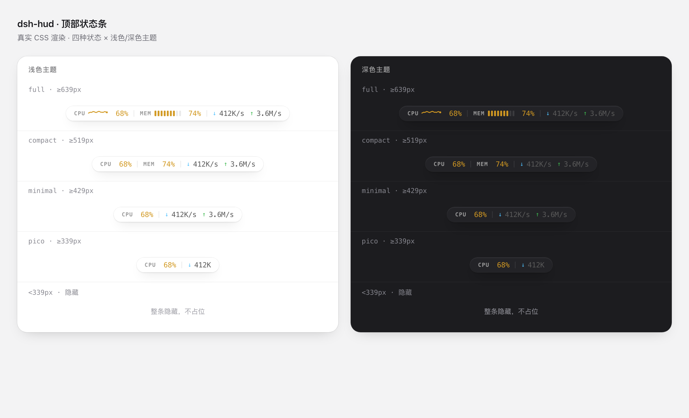

# dsh-sys-status

A compact CPU / memory / network-speed readout for the DeepSeek Harness Web GUI,
placed as a small pill at the **top centre** of the conversation area — deliberately
*not* added to the statistics row under the composer.



```
CPU 12%  ·  内存 8.2G/16G 58%  ·  ↓ 1.2M/s  ↑ 88K/s
```

## Install

```sh
dsh plugin --profile web add dsh-sys-status
```

Reload the browser tab. If the pill does not appear, restart `dsh web` — a newly
added bundle row is only guaranteed to compose at host startup.

## Layout logic

The full window and placement logic — tiers, the measuring chain, placement
order, drag and memory — is written up as a page:
[docs/window-logic.html](docs/window-logic.html).

## What it shows

| Field | Source |
| --- | --- |
| CPU % + 60 s sparkline | `os.cpus()` tick deltas |
| Memory bar (9 segments) | `vm_stat` on macOS (matches Activity Monitor), `os.freemem()` elsewhere |
| Download / upload rate | `netstat -ib` on macOS, `/proc/net/dev` on Linux |

The pill is themed for both light and dark (`body[data-ds-dark-theme]`), coloured
by load (green → amber at 65% → red at 85%), and sized so a centred pill never
jitters: percentages and rates reserve a fixed glyph width. Hover raises it a
pixel and shows a four-line tooltip. Polls every 2 s and pauses while the tab is
hidden — and stops entirely when the pill is collapsed away.

## Responsive behaviour

Other plugins register chips into the very slot this pill lives in — the agent
mode selector and the running-jobs counter. Centring on the row alone puts the
pill on top of them, so placement is computed from the **free band** between the
last chip and the header's trailing controls:

1. Measure the right edge of every chip in the slot, and the left edge of
   `headerUtilities` / `headerCorner`.
2. Try to centre the pill in the row; if that would cross the chips, push it
   past them.
3. If it still does not fit the band, step down a density tier and retry.
4. If no tier fits, hide the pill, render nothing and stop polling.

| Tier | Shows | Typical width |
| --- | --- | --- |
| `full` | sparkline + memory bar + both rates | ~364px |
| `compact` | CPU / MEM + both rates | ~279px |
| `minimal` | CPU + both rates | ~207px |
| `pico` | `CPU 68% ↓ 412K` | ~134px |

Nothing about the geometry is hard-coded:

* The **band** (chip right edge, trailing-control left edge) is read from
  `getBoundingClientRect()` on every measure.
* The **pill width** for the current tier is measured after each paint and
  cached per tier; the table's figures are only a first-frame seed, replaced as
  soon as each tier has rendered once.
* A post-paint check re-solves placement if the real width turns out not to fit,
  so an optimistic seed can cost at most one frame, never an overlap.

The band is measured live, so opening the right panel, collapsing the sidebar or
a second background job appearing re-tiers the pill without a window resize.
Three triggers keep it honest:

* `ResizeObserver` on the title row — column changes the window never hears about.
* `window.resize` — environments that throttle animation frames.
* `MutationObserver` on the pill's own slot — sibling chips (agent mode, running
  jobs) mount *after* this pill and leave the row's width unchanged, so nothing
  else would notice them. Without this the band keeps starting at the row's left
  edge and the pill ends up on top of a job counter that appeared later.

## Drag to move

Automatic placement is a default, not a cage. Drag the pill anywhere inside the
conversation column; it is clamped to the column and the position is saved in
`localStorage` under `dsh-sys-status:position:v1`, so it survives reloads.

* **Drag** — pointer down and move.
* **Double-click** — forget the saved spot and return to automatic placement.

The saved spot is the user's *intent* and is never rewritten. What is rendered is
that intent clamped to the column's current size, so shrinking the window pushes
the pill back inside, and growing it again puts the pill exactly where it was
dropped — the clamp is a view, not an edit.

## Development

```sh
node scripts/behaviour-check.mjs   # mounts the real bundle, resizes, asserts no overlap
node scripts/preview.mjs           # regenerates preview.html from the shipped CSS
```

`preview.mjs` writes `preview.html` from the *real* CSS in `lib/client.js`, so the
mock cannot drift from the shipped styles. Screenshot it with:

```sh
"/Applications/Google Chrome.app/Contents/MacOS/Google Chrome" \
  --headless --screenshot=docs/preview.png --window-size=1120,680 preview.html
```


## Uninstall

```sh
dsh plugin --profile web remove dsh-sys-status
```

## Where it mounts

The browser half registers into `conversation.session.header.utilities`. That
slot is right-aligned inside the header flex row, so the widget positions itself
absolutely and centres on the conversation column. To move it, edit the
`left` / `top` values in `lib/client.js` (`top: 13` is the header title row).

## Host route

`GET /plugins/dsh-sys-status/stats` → `{ cpu, memUsed, memTotal, rxBps, txBps, at }`.

Read-only, same-origin only (`Sec-Fetch-Site: cross-site` → 403), `no-store`,
with a 400 ms snapshot cache so several tabs do not spawn a subprocess storm.
